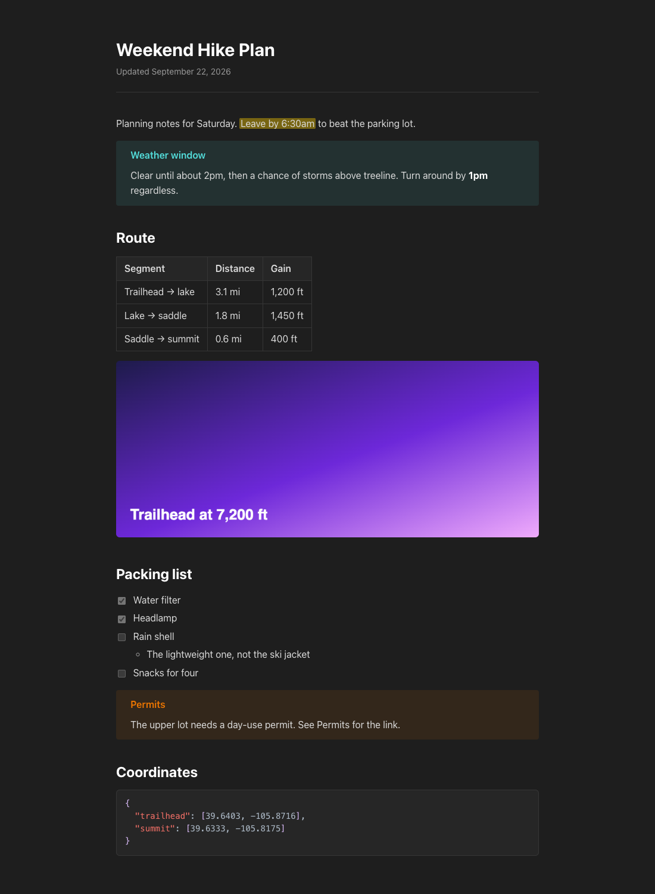
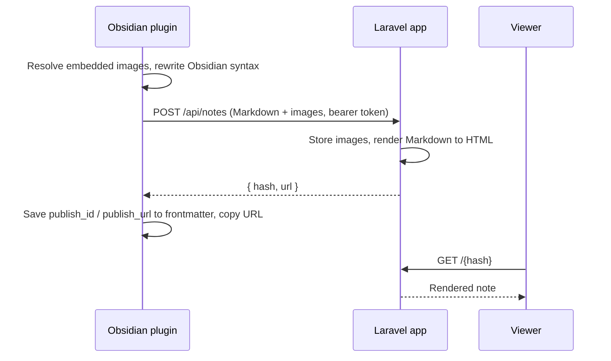

# Obsidian Web Publish

Share a single Obsidian note as a private web page, hosted on your own server. Run **Publish note** in Obsidian and a few seconds later an unlisted link is on your clipboard.



- **One command.** Publish from the command palette or a note's right-click menu. Images the note embeds are uploaded along with it.
- **Private links, no accounts.** Every note gets a random 22-character URL. Anyone with the link can read it, nobody can find it, and there is no index or listing.
- **A push, not a sync.** Nothing leaves your vault until you publish. Publishing again updates the same URL, and unpublishing deletes the page.
- **Looks like Obsidian.** A dark reading view modeled on Obsidian's default theme, with callouts, highlights, tables, task lists and syntax-highlighted code.
- **Yours to host.** A small Laravel app backed by SQLite. There is no third-party service involved.

It has two parts: a Laravel app that stores and renders notes, and an Obsidian plugin that sends them.

## How it works



The plugin turns Obsidian-specific syntax into standard Markdown before uploading. Image embeds are resolved through Obsidian's own link resolution, so they work wherever the images sit in your vault. The server renders the Markdown with [league/commonmark](https://commonmark.thephpleague.com/), plus extensions for callouts and highlights, and stores the resulting HTML.

## What gets published

| In your note | On the web |
|---|---|
| Headings, lists, tables, task lists, links, quotes | Rendered as you'd expect (GitHub Flavored Markdown) |
| `> [!tip] Title` callouts | Styled callouts with Obsidian's colors for each type |
| `==highlight==` | Highlighted text |
| `![[image.png]]`, `![[image.png\|300]]`, `` | Uploaded and shown; a size hint sets the width |
| Fenced code blocks | Syntax highlighted |
| `[[Other note]]`, `[[Other note\|alias]]` | Plain text (linked notes aren't published) |
| `%%comments%%` | Removed |
| Frontmatter | Not published |
| Embedded PDFs or notes | Skipped, and the plugin tells you which ones |
| Raw HTML | Escaped |

## Privacy model

The URL is the only secret. Treat a published link like an unlisted video link: anyone who has it can read the note.

- Hashes are 22 random alphanumeric characters (about 131 bits), so they can't practically be guessed.
- Pages and images send `X-Robots-Tag: noindex, nofollow`, and `robots.txt` disallows everything.
- `Referrer-Policy: no-referrer` stops the URL leaking when a reader clicks an outbound link.
- There's no index page, sitemap or listing; `/` returns 404.
- Links don't expire. Unpublish a note to take it down.
- Your domain name is visible in public certificate transparency logs. Individual note URLs are not.

## Requirements

- PHP 8.3 or newer with the SQLite extension, and Composer
- Node.js 22 or newer, to build the assets and the plugin
- A web server that can run PHP, such as nginx with PHP-FPM
- Obsidian 1.4 or newer

## Server setup

```sh
git clone https://github.com/srtfisher/obsidian-publish.git notes
cd notes
composer install --no-dev --optimize-autoloader
npm ci && npm run build

cp .env.example .env
php artisan key:generate
touch database/database.sqlite
php artisan migrate --force
php artisan storage:link
```

Edit `.env`:

```ini
APP_ENV=production
APP_DEBUG=false
APP_URL=https://notes.example.com
PUBLISH_TOKEN=a-long-random-string
```

Generate a token with `openssl rand -hex 32`. If `PUBLISH_TOKEN` is empty, the API refuses every request.

Point your web server at `public/`. [`deploy/nginx.conf.example`](deploy/nginx.conf.example) is a complete nginx config with HTTPS, an upload limit big enough for screenshots, and `noindex` headers on uploaded images. For a Let's Encrypt certificate:

```sh
certbot certonly --webroot -w /var/www/notes.example.com/public -d notes.example.com
```

Then run `php artisan optimize` and you're live.

## Plugin setup

The plugin isn't in Obsidian's community plugin directory, so you build and install it yourself:

```sh
cd obsidian-plugin
npm ci
OBSIDIAN_VAULT="$HOME/path/to/your/vault" npm run install-vault
```

This builds the plugin and copies it into `.obsidian/plugins/web-publish/` in your vault. Then in Obsidian:

1. Reload Obsidian, open **Settings → Community plugins**, and turn on **Publish to Web**.
2. In the plugin's settings, enter your server URL and the `PUBLISH_TOKEN` from the server's `.env`.

## Usage

| Command | What it does |
|---|---|
| **Publish note** | Uploads the current note and copies its URL to the clipboard. Also in the file menu as **Publish to web**. |
| **Unpublish note** | Deletes the page. The URL returns 404 from then on. |
| **Copy published URL** | Copies the link of a note you've already published. |

After a note is published, its frontmatter holds `publish_id` and `publish_url`. Publishing again replaces the page at the same URL, images included. Delete those two lines if you want the next publish to get a fresh URL.

## API

The plugin uses a small HTTP API, which also works from scripts. Every request needs `Authorization: Bearer $PUBLISH_TOKEN`.

| Method | Path | Body | Response |
|---|---|---|---|
| `POST` | `/api/notes` | multipart: `title`, `markdown`, `assets[]` | `201 {"hash", "url"}` |
| `POST` | `/api/notes/{hash}` | same as above; replaces content and images | `200 {"hash", "url"}` |
| `DELETE` | `/api/notes/{hash}` | none | `204` |

- Assets must be PNG, JPEG, GIF or WebP, up to 20 MB each. SVG is rejected because it can carry scripts.
- Asset file names may contain only letters, numbers, dots, dashes and underscores. Markdown refers to them by relative path, for example ``, and the server rewrites those paths to the stored files.
- An image title of `w=300` becomes a width of 300 pixels.

```sh
curl -X POST https://notes.example.com/api/notes \
  -H "Authorization: Bearer $PUBLISH_TOKEN" \
  -F title="Hello" \
  -F markdown=$'# Hello\n\n' \
  -F "assets[]=@photo.jpg"
```

## Development

```sh
composer install && npm ci && npm run build
cp .env.example .env && php artisan key:generate
php artisan test                     # Pest: API, rendering, public pages
vendor/bin/pint                      # code style

cd obsidian-plugin && npm ci
npm test                             # Vitest: Markdown preprocessing
npm run build                        # type-check and bundle main.js
```

- The renderer lives in `app/Markdown/`.
- The plugin's syntax rewriting is a pure function in `obsidian-plugin/src/preprocess.ts`, and it's where most of the Obsidian-specific edge cases live.

## Continuous deployment (optional)

[`.github/workflows/ci.yml`](.github/workflows/ci.yml) runs both test suites on every push and pull request. To deploy on pushes to `main` as well:

1. Create a GitHub environment named `production` with the secrets `DEPLOY_HOST`, `DEPLOY_USER` and `DEPLOY_SSH_KEY` (a private key).
2. Set the repository variable `DEPLOY_ENABLED` to `true`.
3. On the server, add the matching public key to the deploy user's `authorized_keys`, locked to the deploy script:

   ```
   command="/var/www/notes.example.com/deploy/deploy.sh",no-pty,no-agent-forwarding,no-port-forwarding,no-X11-forwarding ssh-ed25519 AAAA...
   ```

[`deploy/deploy.sh`](deploy/deploy.sh) pulls `main`, installs dependencies, builds assets, runs migrations, rebuilds caches and reloads PHP-FPM. The key can run nothing else.

## License

[MIT](LICENSE). This project is not affiliated with or endorsed by Obsidian or Dynalist Inc.
